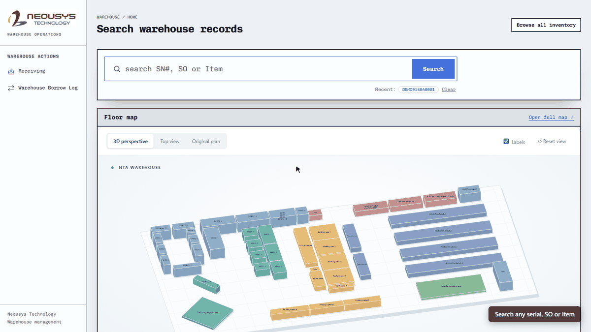

# Neousys Warehouse Operations App

Flask web app for the NTA warehouse, backed by the existing PostgreSQL database
(`receiving_log`, `wo_details`, `outgoing_records`, `warehouse_borrow_log`, ...).



## Features

- **Serial / SO lookup** (sidebar search): finds receiving records by serial number
  (case-insensitive, ignores surrounding spaces, lists *all* matches) plus used
  history from `wo_details`. Order numbers open the work-order viewer.
- **Receiving** (`/receiving`): generate a receiving template from shipment files,
  enter serials by scanning or pasting, generate consecutive serial lists, and
  produce the incoming Word form. See [RECEIVING.md](RECEIVING.md).
- **Work orders** (`/work-orders/`), **Inventory count** (`/inventory-count`),
  **Warehouse borrow log** (`/warehouse-borrow-log/`). See [INVENTORY_LOOKUP.md](INVENTORY_LOOKUP.md).
- **JSON API**: `GET /api/lookup?serial_number=...` and the token-protected
  `POST /api/sheet-update` (see below).

## Setup

```powershell
python -m pip install -r requirements.txt
copy .env.example .env   # then fill in DATABASE_DSN and SECRET_KEY
python scripts/run_web.py
```

The app serves on port 5000: **http://192.168.60.215:5000**.

### Running it on the server (keep QuickBooks PDFs working)

Work-order PDFs live on `\\quickbook2024\d`. Windows only lets programs started from the
**desktop sign-in** use the saved login for that share; a copy started from SSH or a
background script gets "the sign-in was rejected".

- **To start or restart:** on the server desktop (Remote Desktop), double-click
  `Restart Receiving App.cmd` in the project folder and approve the administrator prompt.
  It stops every copy on port 5000, starts one new copy and reports whether the share is
  reachable. Do not start the app from SSH.
- The app refuses to start a second copy on port 5000, and `GET /health` reports whether the
  running copy can open the share (`"ok": true`).

`config.py` loads `.env`; real environment variables take precedence. `.env` is
ignored by Git; never commit credentials. If a password was ever committed or
shared, rotate it: ignoring `.env` does not remove it from Git history.

| Setting | Purpose |
|---|---|
| `DATABASE_DSN` | PostgreSQL URL (URL-encode special characters in the password). Required. |
| `SECRET_KEY` | Stable random key so sessions survive restarts. |
| `MRP_BASE_URL`, `MES_BASE_URL` | Inventory and MES services. |
| `INVOICE_DIR`, `OUTGOING_DIR` | Shared document folders. Default to `~/OneDrive - neousys-tech/Share NTA Warehouse/...` for the user running the app. |
| `RECEIVING_REFERENCE_PATH`, `RECEIVING_INCOMING_TEMPLATE_PATH` | Receiving POD reference workbook and incoming Word template (same OneDrive default). |
| `SHEET_UPDATE_TOKEN` | Enables `POST /api/sheet-update`. Unset = endpoint disabled. |
| `RECEIVING_REQUIRED_SHARES` | Shares checked by `/health` and at startup (`;`-separated). Default `\\quickbook2024\d`. |

## Database safety

- The app **never creates or migrates tables on startup**.
- `python create_db.py` only reports missing model tables. Creating one requires
  approval and an explicit `python create_db.py --create TABLE --confirm`.
- `setup_borrow_log.py` creates only the borrow-log table (see below).
- `scripts/receiving_lookup_indexes.sql` contains *proposed* lookup indexes for
  `receiving_log`. It is not applied automatically; review and approve before running.

## API

- `GET /api/lookup?serial_number=SN` returns the newest match as
  `serial_number`, `part_name`, `entry_date`, plus `match_count` and `matches`.
  Blank/NA placeholders return 400; no match returns 404.
- `POST /api/sheet-update` requires `Authorization: Bearer <SHEET_UPDATE_TOKEN>`.
  JSON accepts only `serial_number`, `entry_date` (YYYY-MM-DD), `invoice_number`,
  `box_number`, `pod_number`, `part_number`, `quantity`. It updates the single row
  with that serial or creates one; serials matching multiple rows return 409.

Documents are served only from the configured folders (`/invoice-download`,
`/outgoing-invoice`) or by database record ID; URLs cannot supply file paths.

## Tests

```powershell
python -m unittest discover -s tests -v
node --test tests/*.test.cjs
```

Tests use in-memory SQLite and mocks, never the production database.
GitHub Actions runs them on every push to `main` and on pull requests
(`.github/workflows/tests.yml`).

# Warehouse Borrow Log

Open `/warehouse-borrow-log/` or use the **Warehouse Borrow Log** tab. Add a borrow
record with **New entry**, which opens the Excel-style grid by default; select its
Borrow ID to edit it or record a return. The grid supports one or up to 100 items per save.
Add/remove rows, tab between cells, or paste an Excel range matching the grid's
column order. New rows copy warehouse, purpose, borrower, and borrow date from the previous row.
New-entry columns are Serial Number, Item Name / #, Borrowed Qty, Warehouse,
Purpose, Borrower, and Borrow Date. New records start with Returned Qty 0 and blank
Return Date and Issued By; those fields remain available when editing saved records.
Each serial has its own lookup. Rows without both serial and item name are skipped.
All used rows are validated and saved in one transaction; errors preserve the grid
and save nothing. Each item receives its own Borrow ID and return tracking.
Returned Qty is the cumulative quantity returned, not the quantity for one return.
Serial Number appears before Item Name / # in the form and table. Typing a serial
automatically looks up `receiving_log.part_number` using a full serial match
(case-insensitive; surrounding spaces and an `S/N` prefix are accepted).
Unknown or unavailable serials allow manual item entry. Changing the serial clears
the previous item, and delayed lookup results never overwrite a newer manual edit.

The module mirrors `Warehouse_Borrowing_Log.xlsx`: the same 13 columns, blue table
format, all-record Open Records and Total Borrowed Qty summaries, yellow quantity
mismatches, orange durations at 31–60 days, and red durations above 60 days.
Status is calculated as BORROWED, PARTIAL RETURN, RETURNED, or ERROR (returned
quantity greater than borrowed quantity). Duration ends on Return Date when entered;
otherwise it uses the server's current date. Leave Return Date blank while items
remain outstanding. Borrow IDs use `BR-yymmdd-NNN`, with a database sequence instead
of a worksheet row; changing Borrow Date changes the date portion of the ID.
Warehouse and purpose suggestions permit custom values, as the workbook does.

Create just the new PostgreSQL table (does not alter existing tables; get approval first):

```powershell
python setup_borrow_log.py
```

Optionally initialize an empty table with the workbook's existing records:

```powershell
python setup_borrow_log.py "C:\path\to\Warehouse_Borrowing_Log.xlsx"
```

Import preserves the worksheet Borrow ID suffixes and skips an already populated
table. It reads but never modifies the workbook; there is no ongoing Excel sync.
Restart the app after deployment. Set `SECRET_KEY` in the app's environment for
sessions that survive restarts; otherwise open forms expire when the app restarts.

Validation and workflow tests use an isolated in-memory database:

```powershell
python -B -m unittest discover -s tests -v
```
